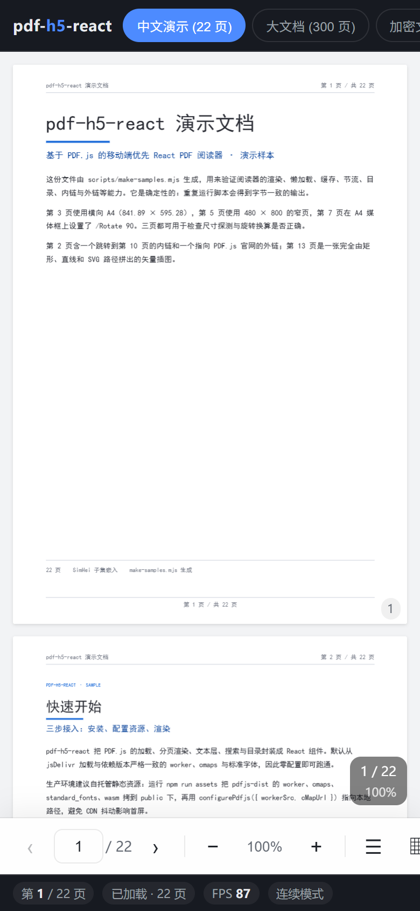
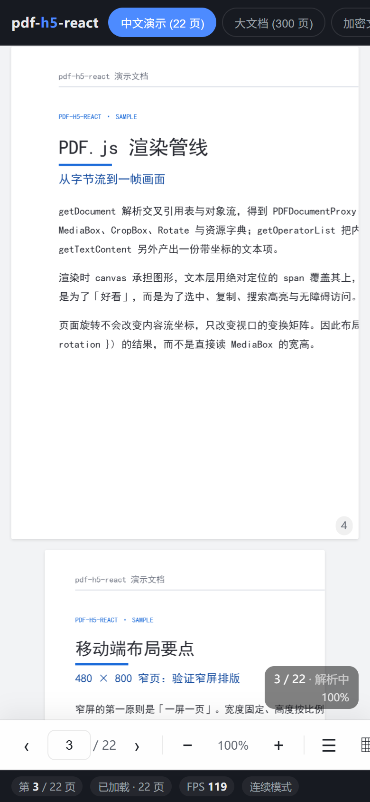
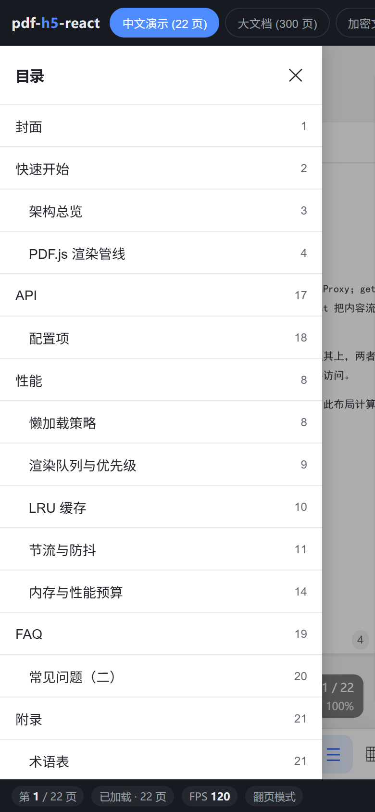
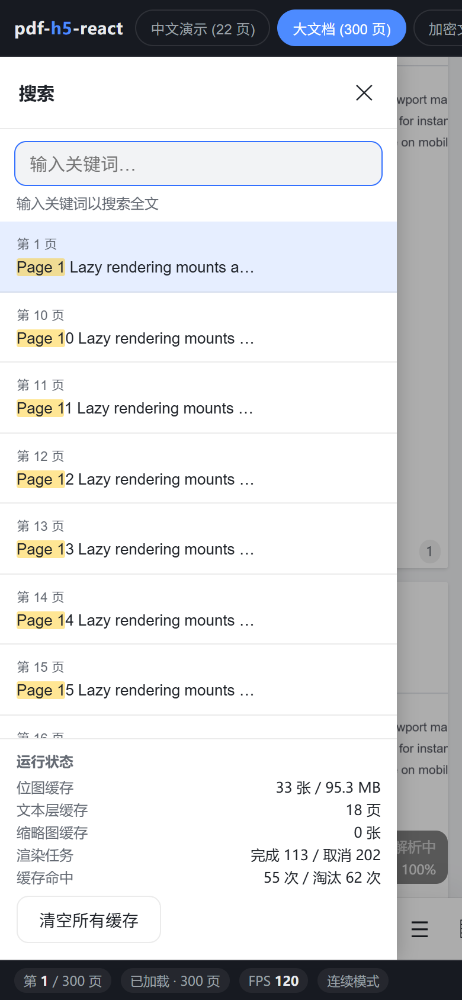
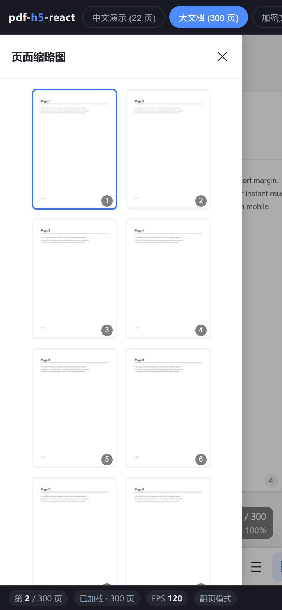
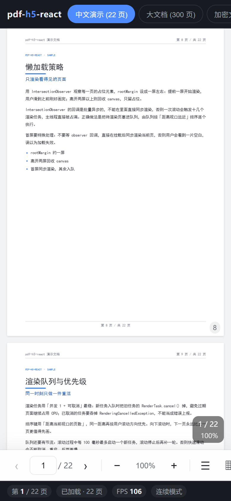
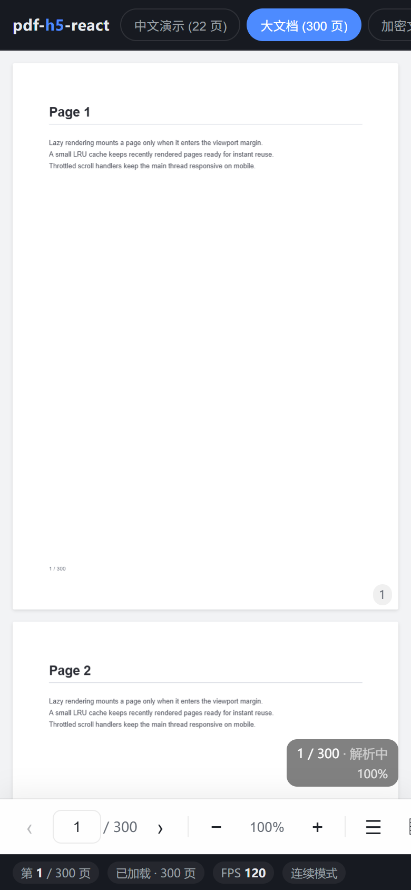
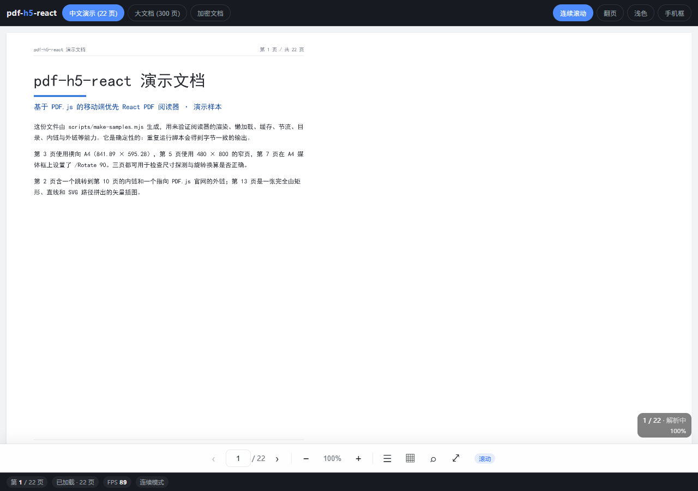

# @superjunjie/pdf-h5-react

基于 [pdf.js](https://mozilla.github.io/pdf.js/) 的**移动端优先** React PDF 阅读器组件。
面向 H5 场景（微信内置浏览器、iOS Safari、Android Chrome），开箱即用，同时把性能和内存控制做在架构里。

[](https://github.com/superjunjie/pdf-h5-react/pkgs/npm/pdf-h5-react)
[](https://github.com/superjunjie/pdf-h5-react/actions/workflows/release.yml)
[](LICENSE)


```
连续滚动 / 翻页吸附 · 捏合缩放 · 双击缩放 · 文本选中 · 全文搜索
缩略图 · 多级目录 · 内链跳转 · 密码文档 · 深浅色主题 · 旋转页 · 混尺寸页面
```

- 组件库本体 **81KB**（gzip 23KB），样式 12KB；`pdfjs-dist` 作为 peerDependency 由使用方安装。
- 300 页文档实测只挂载 **2–9 个页面 DOM**，位图缓存严格受字节上限约束。
- 端到端验证脚本用无头 Chrome 跑真实浏览器，**21 项断言全部通过**（见 [验证](#验证)）。

## 效果

以下截图均由 `npm run verify` 在无头 Chrome 中真实渲染后截取（移动端 390×844 @2x）：

| 连续滚动（中文） | 混尺寸页面（横向 A4 + 窄页） |
| --- | --- |
|  |  |

| 多级目录 | 全文搜索 |
| --- | --- |
|  |  |

| 页面缩略图 | 翻页模式（scroll-snap） |
| --- | --- |
|  |  |

| 300 页大文档 | 桌面端 |
| --- | --- |
|  |  |


---

## 安装

包发布在 **GitHub Packages**，不是公共 npm 源。首次安装需要两步：配置 `.npmrc` + 登录。

> 当前版本：`0.1.0`（[包页面](https://github.com/superjunjie/pdf-h5-react/pkgs/npm/pdf-h5-react)）

### 1. 配置 registry

在项目根目录创建 `.npmrc`（**注意 `@superjunjie` 作用域必须带斜杠**）：

```ini
@superjunjie:registry=https://npm.pkg.github.com
```

### 2. 登录 GitHub Packages

GitHub Packages 强制鉴权，即使包是公开的也必须带着 token 拉取。

```bash
npm login --scope=@superjunjie --auth-type=legacy --registry=https://npm.pkg.github.com
# Username: <你的 GitHub 用户名>
# Password: <Personal Access Token，至少要有 read:packages>
# Email:    <你的邮箱>
```

> `--auth-type=legacy` 是必须的：新版 npm 默认的 web 登录流程对 GitHub Packages 不生效。
> 也可以用环境变量直接注入，适合 CI：
> ```ini
> //npm.pkg.github.com/:_authToken=${GITHUB_TOKEN}
> ```

### 3. 安装

```bash
npm i @superjunjie/pdf-h5-react pdfjs-dist
```

`react` / `react-dom` 是 peer 依赖，宿主项目已有则不会重复安装。

### 生产环境：自托管 pdf.js 资源

库默认从 jsDelivr 加载与依赖版本严格一致的 worker / cmaps / 标准字体 / wasm，**零配置即可运行**。
内网、离线或对 CDN 有顾虑时，把资源拷到自己的静态目录：

```bash
# 在依赖了本包的项目里执行（脚本会从 node_modules 解析 pdfjs-dist 的实际版本）
node node_modules/@superjunjie/pdf-h5-react/scripts/copy-pdfjs-assets.mjs public/pdfjs
```

```ts
import { configurePdfjs } from '@superjunjie/pdf-h5-react';

configurePdfjs({
  workerSrc: '/pdfjs/build/pdf.worker.min.mjs',
  cMapUrl: '/pdfjs/cmaps/',
  standardFontDataUrl: '/pdfjs/standard_fonts/',
  wasmUrl: '/pdfjs/wasm/',
  iccUrl: '/pdfjs/iccs/',
});
```

> `pdfjs` 的 worker 版本必须与 `pdfjs-dist` 一致，否则会抛 `API version does not match Worker version`。
> 仓库里的 `scripts/copy-pdfjs-assets.mjs` 会按 `node_modules` 里的实际版本拷贝，并在目录下写 `VERSION` 文件。

---

## 快速开始

```tsx
import { PdfH5Reader } from '@superjunjie/pdf-h5-react';
import '@superjunjie/pdf-h5-react/style.css';

export default function App() {
  return (
    <div style={{ height: '100dvh' }}>
      <PdfH5Reader src="/files/report.pdf" />
    </div>
  );
}
```

容器必须有确定高度（`height` 不能是 auto），阅读器会填满父容器。


---

## 核心设计

移动端 PDF 阅读的三个真实瓶颈是：**DOM 数量**、**位图内存**、**高频事件**。对应的三层结构与三个机制：

```
usePdfDocument   文档层   加载 / 密码 / 进度（进度事件节流 120ms）
      ↓
usePageMetrics   度量层   首屏并发解析 N 页真实尺寸，其余页渐进解析（rAF 批量校正）
      ↓
useVirtualPages  视图层   只挂载可视区内的页面 DOM
      ↓
RenderQueue      渲染层   可见/预取双并发 + 抢占 + 引用计数取消
```

### 1. 懒加载与性能优化

| 手段 | 实现位置 | 效果（实测） |
| --- | --- | --- |
| 页面 DOM 虚拟化 | `hooks/useVirtualPages.ts` | 300 页文档只挂载 2–9 页 |
| 渐进度量 | `hooks/usePageMetrics.ts` | 首屏只解析 6 页尺寸，其余用均值占位，滚动时按需解析 |
| 渲染档位量化 | `core/layout.ts` `quantizeScale` | 缩放只升不降、命中有限档位，捏合时不重渲染 |
| canvas 限幅 | `core/layout.ts` `clampCanvasSize` | 规避 iOS 约 1670 万像素上限导致的空白画布 |
| 渲染队列双并发 | `core/renderQueue.ts` | 可见页优先（2 并发），预取页低优先（1 并发） |
| 抢占式丢弃 | `RenderQueue.dropPendingPrefetch` | 快速滚动时丢弃无意义的预取任务 |
| 缩略图按区间渲染 | `components/ThumbnailPanel.tsx` | 300 页缩略图只渲染可见行区间 |

### 2. LRU 缓存

四类缓存独立计量，全部按**字节/条目双上限**淘汰（`core/lru.ts`、`core/cache.ts`）：

| 缓存 | 默认上限 | key | 说明 |
| --- | --- | --- | --- |
| 位图 | 96MB | `page@scaleBucket` | 离屏 canvas，缩放来回命中；淘汰时把 canvas 尺寸置 0 尽快归还 GPU 内存 |
| 文本层 | 24 页 / 24MB | `page` | 已构建的 TextLayer DOM，缩放走 `update()` 重排而非重建 |
| 页面代理 | 64 页 | `page` | `PDFPageProxy`，并发请求合并为同一个 Promise |
| 缩略图 | 120 张 | `page` | JPEG dataURL，单张 3–8KB |

两个容易踩的坑，实现里都处理了：

- **唯一超大对象不立刻淘汰**：否则「渲染完就被淘汰 → 下一帧重渲染」会形成抖动。
- **显示 canvas 必须每页独占**：缓存里是共享的离屏位图，而 DOM 节点只有一个父节点；直接把缓存 canvas 挂进页面，后挂载的页会把前面页的 canvas 抢走，表现为空白。因此渲染结果用 `drawImage` 拷到本页 canvas。

### 3. 高频操作节流

`core/throttle.ts` 提供三个原语，全部可通过 `getCacheStats().throttle` 观测：

| 原语 | 用在 | 说明 |
| --- | --- | --- |
| `rafThrottle` | 滚动 → 当前页、缩略图区间 | 每帧最多一次，实测 61 次事件 → 1 次处理 |
| `throttle` | 加载进度、日志上报 | 固定时间窗，首尾可配 |
| `debounce` | 搜索输入（260ms）、重排定位（120ms） | 静默期结束才执行 |
| `rafBatch` | 多页尺寸批量校正 | 一帧内合并多个 setState，避免连续重排 |

捏合缩放走的是**另一条路径**：手势进行中只设置一个 CSS `transform` 做预演（只触发合成，不触发布局），松手后才一次性提交真实 `zoom` + `scroll`。
因为内容（页面、间距、内边距）对 `zoom` 严格线性，预演与提交在数学上等价，松手不会跳变 —— 这一点由 `src/core/gestures.test.ts` 断言。

---

## API

### `<PdfH5Reader />`

| Prop | 类型 | 默认 | 说明 |
| --- | --- | --- | --- |
| `src` | `PdfSource` | — | `string \| URL \| ArrayBuffer \| Uint8Array \| { url, data, password, httpHeaders, withCredentials }` |
| `mode` | `'scroll' \| 'page'` | `'scroll'` | 连续滚动 / 横向翻页（`scroll-snap`，由合成线程处理，比 JS 修正更跟手） |
| `fitMode` | `'width' \| 'page' \| 'none'` | `'width'` | 适配方式 |
| `initialPage` / `initialZoom` | `number` | `1` / `1` | 初始页与初始倍率 |
| `minZoom` / `maxZoom` / `doubleTapZoom` | `number` | `0.5` / `5` / `2.5` | 缩放边界与双击目标 |
| `rotation` | `number` | `0` | 额外旋转（叠加在 PDF 自带 `/Rotate` 之上） |
| `theme` | `'light' \| 'dark' \| 'auto'` | `'auto'` | `auto` 跟随系统并实时响应 |
| `gap` / `padding` | `number` | `12` / `12` | 页间距 / 内容内边距（均随 zoom 缩放） |
| `textLayer` | `boolean` | `true` | 关闭可省内存，代价是不可选中/复制 |
| `links` | `boolean` | `true` | 内链跳转与外链 |
| `toolbar` / `showControls` | `boolean` | `true` | 内置工具栏 / 页码缩放浮层 |
| `bitmapCacheBytes` | `number` | `96MB` | 位图缓存上限 |
| `textLayerCacheEntries` | `number` | `24` | 文本层缓存条目上限 |
| `maxCanvasPixels` / `maxCanvasDimension` | `number` | iOS 安全值 | canvas 限幅 |
| `onDocumentLoad` / `onPageChange` / `onProgress` / `onError` / `onZoomChange` | callback | — | 事件回调（`onProgress` 已节流） |
| `onInternalLink` / `onExternalLink` | callback | — | 拦截链接行为 |
| `renderError` | `(error, retry) => ReactNode` | — | 自定义错误态 |

### 命令式 API（通过 `ref`）

```tsx
const ref = useRef<PdfH5ReaderHandle>(null);

ref.current?.goToPage(10, { smooth: true });
ref.current?.nextPage();
ref.current?.setZoom(2, { x: 200, y: 400 });   // 以视口坐标点为锚点缩放
ref.current?.zoomIn();
ref.current?.resetZoom();
await ref.current?.search('关键词');            // 返回 SearchHit[]
ref.current?.openPanel('outline');              // 'outline' | 'thumbnails' | 'search' | null
ref.current?.getCacheStats();                   // 缓存与渲染运行时统计
ref.current?.clearCaches();
```

### 可单独复用的模块

不想用内置 UI 时，可以只拿底层能力：

```ts
import {
  usePdfDocument, usePageMetrics, useVirtualPages, usePinchGesture,
  RenderQueue, BitmapCache, TextLayerCache, LruCache,
  computeLayout, quantizeScale, clampCanvasSize,
  pinchTransform, pinchCommit, rafThrottle, debounce, rafBatch,
  searchDocument, flattenOutline, createThumbnailCanvas,
} from '@superjunjie/pdf-h5-react';
```

`src/core/{lru,throttle,layout,gestures}.ts` 都是纯函数/纯类，不依赖 React 与 DOM（`clampCanvasSize` 除外），已覆盖单元测试。

---

## 验证

```bash
npm run typecheck   # tsc --noEmit
npm test            # 42 个单元测试（LRU / 节流 / 版面数学 / 手势数学 / 渲染队列 / 文本搜索）
npm run samples     # 生成示例 PDF（含多级书签、混尺寸页、旋转页、加密文档）
npm run assets      # 拷贝 pdf.js 运行时资源到 public/pdfjs
npm run build:demo && npm run preview
npm run verify      # 无头 Chrome 端到端验证 + 截图
```

`npm run verify` 在真实 Chrome 里跑的 21 项断言（最近一次结果）：

```
文档加载成功 · 首屏渲染出图 · 虚拟化只挂载少量页面 · 画布实际有内容
所有可见页均已绘制（无空白页）
300 页文档只挂载极少数页面 · 滚动后挂载数受控 · 快速滚动后仍无空白可见页
LRU 回滚命中 > 0 · 位图缓存始终不超过字节上限 · LRU 有实际淘汰行为
渲染任务有取消而非堆积 · 同一帧滚动风暴合并为一次处理（61 事件 → 1 处理）
全文档搜索命中 · 放大后内容高度按比例增长 · 翻页模式横向吸附生效
缩略图面板可用 · 目录面板可用（17 条多级）· 目录标题可读 · 点击目录可跳转
无未捕获的前端错误
```

截图在 `screenshots/`（`final-*`），报告在 `screenshots/verify-report.json`。

### 示例文档

| 文件 | 页数 | 说明 |
| --- | --- | --- |
| `public/samples/demo-zh.pdf` | 22 | 中文（SimHei 子集嵌入，121KB）；17 条多级书签；第 3 页横向 A4、第 5 页窄页、第 7 页 `/Rotate 90`；内链跳第 10 页、外链到 pdf.js 官网；第 13 页矢量插图 |
| `public/samples/large.pdf` | 300 | 性能压测（163KB） |
| `public/samples/encrypted.pdf` | 1 | 加密文档，**打开密码 `test`**（来自 pdf.js 官方测试集 `issue15893_reduced.pdf`） |

`scripts/make-samples.mjs` 自带断言：页数、大纲条目及 `/Dest` 可解析性、文本层可提取、混尺寸与旋转页、文本不越界、**文本层无 `U+0000`**（字体缺字会静默写入该字符，复制出来是乱码）。

---

## 已知边界

- **不支持表单填写与批注编辑**。链接层只铺透明命中区，没有渲染完整 annotation layer（表单编辑器在 H5 里体积大且收益低）。需要时可用 `pdfjs-dist` 的 `AnnotationLayer` 自行扩展。
- **横向页混排时会出现横向滚动**。为保证全篇缩放一致（视觉整齐），不压缩超宽页；阅读器会自动把横向滚动位置居中，避免看起来「右侧被裁」。
- **canvas 单页上限**。iOS Safari 约 1670 万像素，超限会得到空白画布；`clampCanvasSize` 会自动降分辨率，因此极端放大时是「位图不够清晰」而不是「白屏」。
- **`fitMode: 'page'` 在连续滚动下按宽度优先**，避免窄页被缩得过小；翻页模式下才严格整页可见。
- **加密文档**只走 pdf.js 的密码回调，不支持证书/权限密码的细粒度控制。

## 开发

```bash
npm i
npm run assets      # 首次需要：准备 pdf.js 运行时资源
npm run samples     # 首次需要：生成示例 PDF
npm run dev         # http://127.0.0.1:5273
```

技术栈：Vite 7 + React 19 + TypeScript 5.9 + pdfjs-dist 6（peer）。
库产物为 ESM + 独立 CSS + 完整 `.d.ts`，`react` / `react-dom` / `pdfjs-dist` 均为 external。

## 发布

发布由 [GitHub Actions](.github/workflows/release.yml) 自动完成，鉴权使用仓库自带的 `GITHUB_TOKEN`，
**不需要配置任何 Secret**。

```bash
# 1. 改版本号
npm version 0.2.0 --no-git-tag-version
git commit -am "chore: release v0.2.0"

# 2. 推送并打 tag（脚本会校验 tag 与 package.json 一致）
node scripts/publish-gh.mjs --tag 0.2.0
```

推送 `v*` tag 后 workflow 会依次执行：类型检查 → 单元测试 → 构建库 → 校验 `dist` 产物 → `npm publish`。
版本校验不通过（tag 与 `package.json` 不一致）会直接失败，避免发错版本。

也可以在 [Actions 页面](https://github.com/superjunjie/pdf-h5-react/actions/workflows/release.yml)
手动触发 `Run workflow`，并用输入框覆盖版本号。

> 发到 GitHub Packages 的包**即使公开也强制鉴权**，所以使用方必须配 `.npmrc` 并登录（见上文「安装」）。
> 这是平台限制，不是包的配置问题。

## License

MIT

